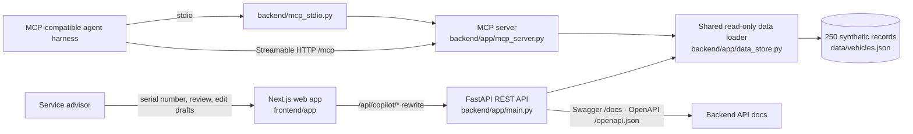

# Service Lane Copilot

For a quick project overview, see [`CONTEXT.md`](CONTEXT.md). Product requirements and acceptance criteria are maintained in [`SERVICE_LANE_COPILOT_SPEC.md`](SERVICE_LANE_COPILOT_SPEC.md).

Service Lane Copilot is a synthetic-data demo for dealership service advisors. The project uses a **Next.js + React + TypeScript frontend** and a **Python FastAPI backend**. The backend reads the 250 synthetic vehicle records from `data/vehicles.json` and exposes them through both a read-only REST API and a standard **Model Context Protocol (MCP)** server for MCP-compatible agent harnesses.

All vehicle details, service events, mileage, recommendations, and maintenance thresholds are fictional demo content. Do not use the demo rules to make real maintenance decisions. No real dealership systems, customers, or outside history services are connected.

An OBD-II/CAN adapter is a planned optional source for a later connected version. It may provide the vehicle VIN; an approved VIN decoder/catalog can resolve make, model, and year. Odometer availability varies by vehicle and adapter, so the app must handle unavailable readings explicitly. OBD data does not provide dealership service history; that remains a separate data source. The current demo does not connect to a vehicle.

## Architecture at a glance



The web app and MCP server use the same synthetic data loader. Recommendations are explicit demo data with visible history evidence. Drafts are returned for advisor review only; the app does not send, submit, or persist them.

## Folder structure

```text
service-lane-copilot/
├── AGENTS.md                         # Agent workflow and safety rules
├── CONTEXT.md                        # Short onboarding overview
├── MEMORY.md                         # Verified architecture and open gaps
├── README.md                         # Setup, architecture, and folder map
├── SERVICE_LANE_COPILOT_SPEC.md      # Requirements and acceptance criteria
├── data/
│   └── vehicles.json                 # 250 synthetic vehicle/history records
├── docs/
│   └── feature-spec-template.md      # Template for a new feature spec
├── backend/
│   ├── requirements.txt              # Pinned Python dependencies
│   ├── mcp_stdio.py                  # Local stdio MCP launcher
│   └── app/
│       ├── main.py                   # REST routes and HTTP MCP mount
│       ├── mcp_server.py             # MCP tools and resources
│       └── data_store.py             # Shared read-only data loader
└── frontend/
    ├── package.json                  # Frontend scripts and dependencies
    ├── next.config.ts                # Backend API rewrite
    └── app/
        ├── page.tsx                  # Main advisor screen
        ├── layout.tsx                # App shell and metadata
        └── globals.css               # Global styles
```

The tree shows the main source files and intentionally omits generated folders such as `node_modules/`, `.next/`, and Python virtual environments.

## Key files and what they contain

| File | What it contains |
| --- | --- |
| `AGENTS.md` | Required workflow, safety boundaries, and documentation upkeep rules for coding agents. |
| `CONTEXT.md` | Short onboarding explanation of the project and links to the authoritative docs. |
| `MEMORY.md` | Verified architecture, local run commands, current implementation status, and known gaps. |
| `SERVICE_LANE_COPILOT_SPEC.md` | Product requirements, boundaries, acceptance criteria, and the verification plan. |
| `README.md` | Setup instructions, architecture diagram, folder tree, file guide, endpoints, and sample serial numbers. |
| `data/vehicles.json` | The 250 fictional vehicle records, service histories, and explicit demo recommendation examples used by the app. |
| `backend/requirements.txt` | Pinned Python packages for FastAPI, Uvicorn, and MCP. |
| `backend/mcp_stdio.py` | Entry point for MCP clients that start the server as a local subprocess. |
| `backend/app/main.py` | FastAPI application, REST endpoints, and mounted Streamable HTTP MCP endpoint. |
| `backend/app/mcp_server.py` | MCP server setup, read-only tools, resources, and draft responses. |
| `backend/app/data_store.py` | Shared loader and validation for the synthetic JSON records. |
| `frontend/package.json` | Frontend scripts and pinned direct dependencies. |
| `frontend/package-lock.json` | Exact resolved frontend dependency versions for repeatable npm installs. |
| `frontend/next.config.ts` | Rewrite from browser `/api/copilot/*` requests to the local FastAPI `/api/*` routes. |
| `frontend/.env.local.example` | Example backend URL setting for local development. |
| `frontend/app/page.tsx` | Main advisor lookup and service-history screen. |
| `frontend/app/layout.tsx` | Shared page shell and document metadata. |
| `frontend/app/globals.css` | App-wide styles. |
| `frontend/tsconfig.json` | TypeScript compiler configuration used by Next.js. |
| `frontend/next-env.d.ts` | Next.js generated TypeScript environment declarations. |
| `docs/feature-spec-template.md` | Template for specifying a distinct feature before implementation. |
| `docs/links.txt` | Project reference links. |
| `docs/AI_Agent_Project_Guide_Local_and_Free_Models.pdf` | Supporting project reference material. |
| `docs/Day 1 - Part 2 (To deliver) - AI in 2026.pptx` | Slides that introduced the project idea. |

Next.js generates `frontend/AGENTS.md` with framework-specific coding guidance when the dev server runs. It is generated output; read its guidance, but do not treat it as the product requirements source.

## Requirements

- Node.js 20.9 or newer for Next.js.
- Python 3.11 or newer for the FastAPI backend and current MCP Python SDK.
- npm (included with Node.js) and pip (included with Python).

## Run locally on Windows PowerShell

Open two terminals in the project folder.

### Terminal 1: Python API

```powershell
cd backend
py -3 -m venv .venv
.\.venv\Scripts\python.exe -m pip install -r requirements.txt
.\.venv\Scripts\python.exe -m uvicorn app.main:app --reload --host 127.0.0.1 --port 8000
```

Swagger UI is at `http://127.0.0.1:8000/docs`; it documents the REST endpoints and points to the MCP interface overview. The raw OpenAPI schema is at `http://127.0.0.1:8000/openapi.json`, backend capabilities are at `http://127.0.0.1:8000/api/capabilities`, the health check is at `http://127.0.0.1:8000/api/health`, and the MCP Streamable HTTP endpoint is `http://127.0.0.1:8000/mcp`. MCP messages use the MCP protocol, so the MCP tool list is described in the overview rather than represented as OpenAPI routes.

### Terminal 2: Next.js web app

```powershell
cd frontend
npm install
npm run dev
```

Open `http://localhost:3000`. The Next.js rewrite proxies `/api/copilot/*` calls to the local Python API. Copy `frontend/.env.local.example` to `frontend/.env.local` and change `BACKEND_API_URL` only if the API is running at another address.

## Connect an MCP-compatible agent harness

The HTTP server uses MCP Streamable HTTP at `http://127.0.0.1:8000/mcp`. Start the Python API first, then add that URL as an MCP server in your harness. The harness must run on the same machine to reach the local-only endpoint.

For a harness that launches local MCP servers over stdio, configure it with the backend virtual-environment Python and this script:

```text
<project>/backend/.venv/Scripts/python.exe <project>/backend/mcp_stdio.py
```

The exact configuration-file format differs by harness. Replace `<project>` with this workspace's absolute path.

### Exposed MCP capabilities

- `search_vehicle_records` — find synthetic records by serial, make, or model.
- `get_vehicle_record` — retrieve one synthetic record with its service history and demo recommendations.
- `create_customer_draft` — prepare an explanation, quote, or follow-up draft.
- `create_record_request_draft` — prepare a record-intake or outside-history request draft.
- `dataset_summary` — report the demo data boundary and record count.
- `service-lane://demo-guide` and `vehicle://{serial}` — read-only resources.

All tools are read-only. Draft tools return `sent: false` and do not contact a customer, dealership, vehicle, or external service. The MCP endpoint binds to localhost with the dev server. Do not expose it to a network or public hostname without adding authentication and deployment security controls.

Direct runtime versions are pinned in `frontend/package.json` and `backend/requirements.txt`. The frontend requires Node.js 20.9 or newer.

## Sample serial numbers

`NS-2048`, `NS-7316`, `NS-5192`, `NS-8840`, `NS-4402`, `NS-1026`, `NS-6621`, `NS-3574`, `NS-9031`, `NS-2258`, and generated examples `DEMO-0011` through `DEMO-0250`.

The sample scenarios include due and coming-up items, no matching recommendation, missing mileage, stale mileage, conflicting mileage, safety verification prompts, and unknown serial numbers. Unknown or incomplete records offer editable drafts only. Nothing is sent or submitted.


