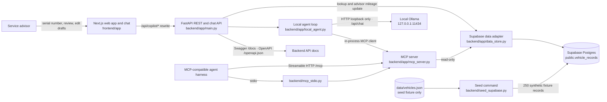

# Service Lane Copilot

For a quick project overview, see [`CONTEXT.md`](CONTEXT.md). Product requirements and acceptance criteria are maintained in [`SERVICE_LANE_COPILOT_SPEC.md`](SERVICE_LANE_COPILOT_SPEC.md).

Service Lane Copilot is a synthetic-data demo for dealership service advisors. The project uses a **Next.js + React + TypeScript frontend** and a **Python FastAPI backend**. The Python backend reads and updates synthetic vehicle records in **Supabase Postgres** and exposes them through a **Model Context Protocol (MCP)** server and REST API for MCP-compatible agent harnesses and the web UI. The 250-record `data/vehicles.json` file is a seed fixture, not a runtime fallback. MCP remains read-only; the local REST mileage endpoint is the sole write path.

All vehicle details, service events, mileage, recommendations, and maintenance thresholds are fictional demo content. Do not use the demo rules to make real maintenance decisions. No real dealership systems, customers, or outside history services are connected.

An OBD-II/CAN adapter is a planned optional source for a later connected version. It may provide the vehicle VIN; an approved VIN decoder/catalog can resolve make, model, and year. Odometer availability varies by vehicle and adapter, so the app must handle unavailable readings explicitly. OBD data does not provide dealership service history; that remains a separate data source. The current demo does not connect to a vehicle.

## Architecture at a glance



The web app chat uses only local Ollama and calls the same registered MCP server in-process. The MCP tools and resources use the shared Supabase-backed synthetic records. Recommendations are explicit demo data with visible history evidence. Drafts are returned for advisor review only; the app does not send or submit them.

## Folder structure

```text
service-lane-copilot/
├── AGENTS.md                         # Agent workflow and safety rules
├── .github/
│   └── workflows/verify.yml           # Backend regression and frontend build checks on PRs
├── CONTEXT.md                        # Short onboarding overview
├── MEMORY.md                         # Verified architecture and open gaps
├── README.md                         # Setup, architecture, and folder map
├── SERVICE_LANE_COPILOT_SPEC.md      # Requirements and acceptance criteria
├── data/
│   └── vehicles.json                 # 250 synthetic seed fixture records
├── supabase/
│   ├── config.toml                   # Local Supabase project configuration
│   └── migrations/                   # Postgres schema, RLS, and grants
├── docs/
│   ├── feature-spec-template.md      # Template for a new feature spec
│   ├── feature-spec-manual-mileage.md # Mileage replacement scope and evidence limits
│   ├── feature-spec-local-ollama-chat.md # Local chat requirements and boundaries
│   └── feature-spec-supabase-database.md # Supabase runtime store and seed behavior
├── backend/
│   ├── .env.example                  # Backend-only Supabase environment template
│   ├── requirements.txt              # Pinned Python dependencies
│   ├── seed_supabase.py              # Idempotent synthetic fixture loader
│   ├── mcp_stdio.py                  # Local stdio MCP launcher
│   ├── tests/
│   │   ├── test_mileage.py           # Mileage replacement and API regression checks
│   │   └── test_supabase_store.py    # Supabase adapter, seed, and migration checks
│   └── app/
│       ├── main.py                   # REST, local chat, mileage, and HTTP MCP routes
│       ├── local_agent.py            # Local Ollama and MCP tool orchestration
│       ├── mcp_server.py             # Read-only MCP tools and resources
│       └── data_store.py             # Supabase data access and mileage update
└── frontend/
    ├── package.json                  # Frontend scripts and dependencies
    ├── next.config.ts                # Backend API rewrite
    └── app/
        ├── icon.svg                 # Browser-tab favicon
        ├── page.tsx                  # Main advisor screen
        ├── chat-panel.tsx             # Advisor chat using local Ollama and MCP
        ├── layout.tsx                # App shell and metadata
        └── globals.css               # Global styles
```

The tree shows the main source files and intentionally omits generated folders such as `node_modules/`, `.next/`, and Python virtual environments.

## Key files and what they contain

| File | What it contains |
| --- | --- |
| `AGENTS.md` | Required workflow, safety boundaries, and documentation upkeep rules for coding agents. |
| `.github/workflows/verify.yml` | Runs backend regression checks and the frontend production build for pull requests and main pushes. |
| `CONTEXT.md` | Short onboarding explanation of the project and links to the authoritative docs. |
| `MEMORY.md` | Verified architecture, local run commands, current implementation status, and known gaps. |
| `SERVICE_LANE_COPILOT_SPEC.md` | Product requirements, boundaries, acceptance criteria, and the verification plan. |
| `docs/feature-spec-local-ollama-chat.md` | In-app assistant behavior, local-only model policy, and MCP capability access. |
| `docs/feature-spec-manual-mileage.md` | Advisor-approved mileage replacement, provenance, and history evidence limits. |
| `README.md` | Setup instructions, architecture diagram, folder tree, file guide, endpoints, and sample serial numbers. |
| `data/vehicles.json` | The 250 fictional seed records; loaded into Supabase by the seed command and never read at runtime. |
| `supabase/config.toml` and `supabase/migrations/` | Local Supabase configuration and private vehicle table schema with row-level security. |
| `docs/feature-spec-supabase-database.md` | Approved Supabase runtime, credentials, seed, and failure behavior. |
| `backend/seed_supabase.py` | Idempotently loads the synthetic JSON fixture into `public.vehicle_records`. |
| `backend/app/data_store.py` | Supabase runtime reads and advisor mileage updates. |
| `backend/requirements.txt` | Pinned Python packages for FastAPI, Uvicorn, MCP, Supabase, and environment loading. |
| `backend/mcp_stdio.py` | Entry point for MCP clients that start the server as a local subprocess. |
| `backend/app/main.py` | FastAPI REST, local-chat and mileage endpoints, and mounted Streamable HTTP MCP endpoint. |
| `backend/app/mcp_server.py` | MCP server setup, read-only tools, resources, and draft responses exposed to both harnesses and in-app chat. |
| `backend/app/local_agent.py` | Local Ollama model discovery, bounded tool loop, MCP tool/resource dispatch, and grounding instructions. |
| `backend/tests/test_supabase_store.py` | Database adapter, fixture seed validation, and migration access checks. |
| `backend/tests/test_mileage.py` | Standard-library regression checks for replacement, provenance, conflict, and API validation. |
| `frontend/package.json` | Frontend scripts and pinned direct dependencies. |
| `frontend/package-lock.json` | Exact resolved frontend dependency versions for repeatable npm installs. |
| `frontend/next.config.ts` | Rewrite from browser `/api/copilot/*` requests to the local FastAPI `/api/*` routes. |
| `frontend/.env.local.example` | Example backend URL setting for local development. |
| `frontend/app/page.tsx` | Main advisor lookup and service-history screen with the local chat panel mounted. |
| `frontend/app/layout.tsx` | Shared page shell and document metadata. |
| `frontend/app/chat-panel.tsx` | In-app assistant conversation, local model selection, and MCP tool usage display. |
| `frontend/app/icon.svg` | Service Lane Copilot favicon for browser tabs. |
| `frontend/app/globals.css` | App-wide styles. |
| `frontend/tsconfig.json` | TypeScript compiler configuration used by Next.js. |
| `frontend/next-env.d.ts` | Next.js generated TypeScript environment declarations. |
| `docs/feature-spec-template.md` | Template for specifying a distinct feature before implementation. |
| `docs/links.txt` | Project reference links. |
| `docs/AI_Agent_Project_Guide_Local_and_Free_Models.pdf` | Supporting project reference material. |
| `docs/Day 1 - Part 2 (To deliver) - AI in 2026.pptx` | Slides that introduced the project idea. |

Next.js generates `frontend/AGENTS.md` with framework-specific coding guidance when the dev server runs. It is generated output; read its guidance, but do not treat it as the product requirements source.

## Requirements

- Node.js 20.9 or newer for Next.js.
- Python 3.11 or newer for the FastAPI backend and current MCP Python SDK.
- npm (included with Node.js) and pip (included with Python).

## Supabase database setup

The backend requires a Supabase Postgres instance. You can use the local Supabase stack or a Supabase project you manage. This repository does not provision a hosted project.

### Local Supabase

1. Install the Supabase CLI and start a Docker-compatible container runtime.
2. From the project root, run:

```powershell
supabase start
supabase db reset
```

3. Copy `backend/.env.example` to `backend/.env`. Set `SUPABASE_URL` and `SUPABASE_SECRET_KEY` to the local API URL and local secret/service-role key printed by `supabase status`.
4. From `backend/`, install requirements and run `python seed_supabase.py`. The command upserts the 250 synthetic fixtures and can be rerun safely.

### Hosted Supabase project

Apply the repository migration to your own project using the Supabase CLI linked to that project, then set its project URL and secret key in the backend's ignored `backend/.env`. Run `python seed_supabase.py` from `backend/` to load the synthetic demo rows. Keep the secret key on the Python backend; never place it in frontend environment variables or browser code. The app returns a safe unavailable response when Supabase is missing and does not fall back to the JSON fixture.

The database table has row-level security enabled and grants access only to the backend service role. Keep the API and MCP server local to the machine for this demo.

## Run locally on Windows PowerShell

Open two terminals in the project folder.

### Terminal 1: Python API

```powershell
cd backend
py -3 -m venv .venv
.\.venv\Scripts\python.exe -m pip install -r requirements.txt
.\.venv\Scripts\python.exe -m uvicorn app.main:app --reload --host 127.0.0.1 --port 8000
```

Swagger UI is at `http://127.0.0.1:8000/docs`; it documents the REST endpoints including `PATCH /api/vehicles/{serial}/mileage` (the only local synthetic-data write route) and points to the read-only MCP interface overview. The raw OpenAPI schema is at `http://127.0.0.1:8000/openapi.json`, backend capabilities are at `http://127.0.0.1:8000/api/capabilities`, the health check is at `http://127.0.0.1:8000/api/health`, and the MCP Streamable HTTP endpoint is `http://127.0.0.1:8000/mcp`. MCP messages use the MCP protocol, so the MCP tool list is described in the overview rather than represented as OpenAPI routes.

### Terminal 2: Next.js web app

```powershell
cd frontend
npm install
npm run dev
```

Open `http://localhost:3000`. The Next.js rewrite proxies `/api/copilot/*` calls to the local Python API. Copy `frontend/.env.local.example` to `frontend/.env.local` and change `BACKEND_API_URL` only if the API is running at another address.

### Enable in-app local chat

Start the Ollama app and confirm its local API is available at `http://127.0.0.1:11434`. Run `ollama list` to see installed models, then open **Ask Copilot** and select one of them. The model storage folder (including a D: drive folder) is handled by your local Ollama installation; the app lists models available from that instance. If Ollama is stopped or has no models, vehicle lookup and the rest of the app remain available, while chat shows a setup message. The selected model must support tool calling for record lookups and MCP actions.

Chat and tool results are sent only to the local Ollama service. The assistant uses every tool and resource registered by the app's MCP server. The assistant itself cannot send messages, update records, book service, access a vehicle, or use an external model/service; advisors update synthetic mileage separately through the REST form.

## Connect an MCP-compatible agent harness

The HTTP server uses MCP Streamable HTTP at `http://127.0.0.1:8000/mcp`. Start the Python API first, then add that URL as an MCP server in your harness. The harness must run on the same machine to reach the local-only endpoint.

For a harness that launches local MCP servers over stdio, configure it with the backend virtual-environment Python and this script:

```text
<project>/backend/.venv/Scripts/python.exe <project>/backend/mcp_stdio.py
```

The exact configuration-file format differs by harness. Replace `<project>` with this workspace's absolute path.

### Exposed MCP capabilities

- `search_vehicle_records` — find synthetic records by serial, make, or model.
- `get_vehicle_record` — retrieve one synthetic record with its service history and demo recommendations.
- `create_customer_draft` — prepare an explanation, quote, or follow-up draft.
- `create_record_request_draft` — prepare a record-intake or outside-history request draft.
- `dataset_summary` — report the demo data boundary and record count.
- `service-lane://demo-guide` and `vehicle://{serial}` — read-only resources.

All MCP tools are read-only. Draft tools return `sent: false` and do not contact a customer, dealership, vehicle, or external service. The MCP endpoint binds to localhost with the dev server. Do not expose it to a network or public hostname without adding authentication and deployment security controls.

Run backend regression checks from `backend/` with `python -m unittest discover -s tests -v`. The local mileage update is the only REST operation that changes synthetic records in Supabase.\n\nDirect runtime versions are pinned in `frontend/package.json` and `backend/requirements.txt`. The frontend requires Node.js 20.9 or newer.

## Sample serial numbers

`NS-2048`, `NS-7316`, `NS-5192`, `NS-8840`, `NS-4402`, `NS-1026`, `NS-6621`, `NS-3574`, `NS-9031`, `NS-2258`, and generated examples `DEMO-0011` through `DEMO-0250`.

The sample scenarios include due and coming-up items, no matching recommendation, missing mileage, stale mileage, conflicting mileage, safety verification prompts, and unknown serial numbers. Unknown or incomplete records offer editable drafts only. Nothing is sent or submitted.


